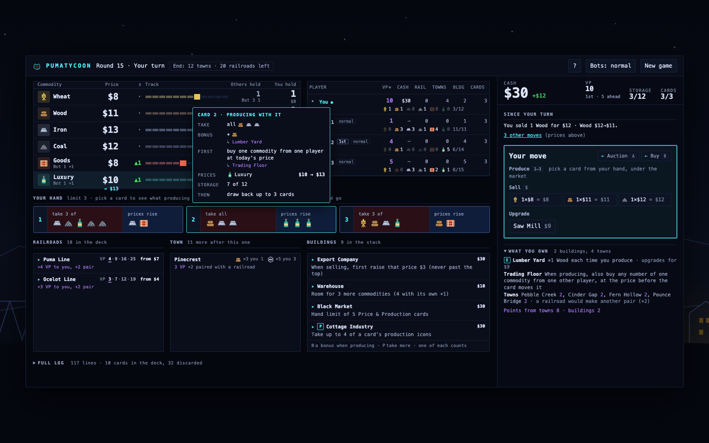
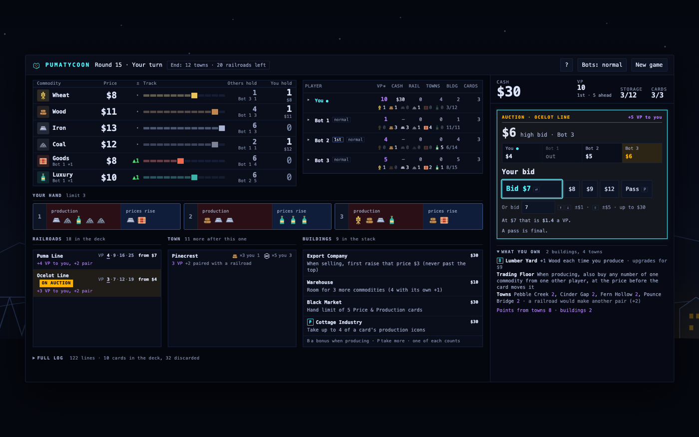

# PumaTycoon

**Produce, sell into a market you and your rivals keep moving, and outbid
them for the railroads.** A trading game for 2–5 players: against bots,
against friends sharing one screen, or any mix of the two.

**Play it at <https://greykit.com/games/pumatycoon/>.** It runs in the
browser, with nothing to install and no account.

## How it plays

On your turn you take one action:

- **Produce**: play a card from your hand. Take commodities from its
  Production half, then every price in its Price half goes up.
- **Sell**: sell any amount of one commodity at its current price. The price
  then drops $1 for every unit sold.
- **Auction**: put a railroad up for bids. Lose the auction and you act again.
- **Buy a building**, or upgrade a commodity building you already own.
- **Build a town**, paid for in commodities.

Every producer pushes prices up and every seller pushes them down, so the
market is yours to move, and everyone else's.

The game ends when the last town is built or the last railroad is auctioned.
The round is played out so everyone has the same number of turns, then the
points are counted:

- each town's points
- each railroad line's points, read from its card by how many of that line
  you own
- 1 point per building, plus the end-game bonuses some buildings give
- 2 points for every town you can pair with a railroad card
- your mission, if missions are in play

The most points wins. A tie goes to whoever has more money.

**New to it?** Leave the walkthrough on at setup and the game gives a
one-minute tour of the table at your first move. Press `?` at any time for
the rules, the scoring and the keys.

## Setting up

The title screen's **New quick game** starts straight away with the seats and
rules you used last: the first time, you against two bots. **Custom game**
sets them:

- **2–5 seats**, each a human or a bot. Bots play at Easy, Normal or Hard. A
  random seat starts.
- **Humans share one screen.** Each player's money, hand and mission stay
  hidden until they take the keyboard; a curtain covers the private part of
  the screen between turns, and `Enter` lifts it. In an auction the handover
  is a line in the bidding box, so a bidding war between two people is just
  `Enter`, `Enter`.
- **Optional rules**:
  - *Mission cards*: each player is dealt two secret missions and keeps one,
    scored at the end.
  - *Sudden death*: a player holding $1,000 may end the game and win.
  - *Beginners*: no advanced buildings, only the four commodity buildings on
    offer at the start.
  - *Basic buildings by player count*: one commodity building per player on
    offer, the rest of the row from the advanced stack. Can't be combined
    with Beginners.
- **Ending**: *Standard* ends at the last town or the last railroad. *Long*
  runs until two of the three (towns, railroads, buildings) are all owned.
- **Two players** play with their own rules automatically: some railroads
  and towns are removed, and each auction is one bid each.

A game is about 30 rounds.

## Reading the screen

The market runs across the top: six prices, each on its track, with how far
it has moved since your last turn and who moved it. Beside it are the
standings. Below sit the railroads, the town and the buildings, each showing
what it is worth to you, and under those the log, newest move first.

Your desk is on the right: your cash, your actions, and a recap of what
happened since your turn. Your hand of cards sits beneath the market.

Nothing happens by surprise. Every choice shows what it would do (the money,
the price moves, the points) before you commit, and anything that spends
takes a second press. The header counts down to the end of the game and
turns amber when a single purchase would finish it.

## Controls

| Key | |
|---|---|
| `1`–`5` | preview producing with that card; `Enter` on **Produce** commits (or double-click a card) |
| `S` | jump to Sell |
| `A` `B` `T` | jump to the railroads, buildings or town; the arrow keys walk the list. A jump never commits |
| `A` while selling | sell all |
| `Esc` | put back the card or purchase you're previewing |
| `Enter` | take the keyboard when it's passed to you |
| `Enter` | in an auction: bid the amount shown (the minimum, unless you change it) |
| `↑` `↓` | in an auction: change your bid by $1, or $5 with `Shift` |
| `P` | in an auction: pass |
| `Esc` | in an auction: take back an auction you haven't opened yet |
| `?` | how to play; `Esc` closes it |
| `Enter` / `→`, `←`, `Esc` | next, back and end, in the walkthrough |

Everything else is a button, and a button is only live when it answers the
question the game is asking. Hovering over a choice lights up the prices it
would move. Moves are announced to screen readers, and the ones made while
you wait are read out when your turn comes.

## Fine print

A few rules can be read more than one way. Here they play like this:

- Opening an auction is a bid of at least the railroad's minimum. If everyone
  else passes, the opener wins it at that bid.
- Winning bids go to the bank. The Auction House's $5 arrives after the
  auction, so it can't help pay the bid. It pays its owner on their own
  auctions too.
- A price never leaves its track: rises stop at the top, sales stop at the
  bottom.
- Commodities never run out.
- When the Price & Production deck runs out, the discards are shuffled into
  a new one.
- Cottage Industry and Factory never take more than the card shows.
- A bigger hand from the Smuggler or Black Market fills at your next
  production, not when you buy it.
- A building works from the moment it's bought, so a Construction Company
  allows its own second purchase.
- Freight Company's second sale must be a different commodity.
- A Trading Floor purchase pays the other player the market price. It is not
  a sale: no price drop, no Trading Firm income, no Export Company rise.
- Trading Firm income is paid by the bank, and a Trading Firm pays on its
  owner's own sales too.
- Brick Works takes one off either way of paying for a town.
- Mayor's Office counts itself among your buildings.
- The Machine Shop / Water Mill is in the advanced stack.
- A tie for "most" on a mission scores nothing.
- Sudden Death is offered at the start of your own turn, while you hold
  $1,000.
- In a two-player game, which towns are removed is random.
- "The last railroad is auctioned" means none are left to deal and none are
  on offer.
- A tie on both points and money is shared.

## Bots

Bots weigh every move in points and take the best one. A lower skill adds
more noise to that judgement and reads railroads and towns less well: Hard
beats Normal about six games in ten, and beats Easy about 85% of the time.
In the final round a bot turns its cash into points.

**Bot speed** in the header, or in **Settings** on the title screen, sets how
long the bots take over each move. **Menu** in the header goes back to the
title screen.

Bots can see everyone's money. At the table money is secret, but every move
that changes it is public, so a careful player can keep count too.

## Saving

The game saves itself after every move, mid-auction included. Close the
tab, come back later, and **Resume game** on the title screen picks it up
where you left off. The save lives in this browser only, and starting a new
game replaces it.

## Other Puma games

[PumaRally](https://greykit.com/games/pumarally/) ·
[PumaTriage](https://greykit.com/games/pumatriage/) ·
[PumaHeart](https://greykit.com/games/pumaheart/) ·
[PumaTower](https://greykit.com/games/pumatower/) ·
[more](https://greykit.com/games/)

## Credits

Made by shandower, with AI assistance from Claude. MIT licensed.
